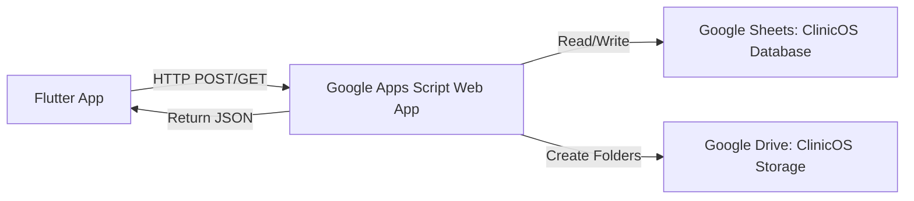

# ClinicOS — Milestone 1: Patient → Sheets → Drive Pipeline

## Goal

Build the first working version of ClinicOS where a patient can be created from a Flutter app, permanently stored in Google Sheets, with a corresponding folder structure created in Google Drive. Data must persist across app restarts and be accessible from any device.

## Architecture Overview



---

## User Review Required

> [!IMPORTANT]
> **Google Apps Script Deployment**: After I create the Apps Script code, you will need to:
> 1. Create a new Google Apps Script project at [script.google.com](https://script.google.com)
> 2. Paste the code I provide
> 3. Deploy as a Web App (Execute as: **You**, Access: **Anyone**)
> 4. Copy the deployment URL into the Flutter app's configuration
> 5. Create the Google Sheet and Drive folder manually (instructions provided)

> [!WARNING]
> **No authentication in Milestone 1**: The Apps Script web app will be publicly accessible (anyone with the URL can call it). This is intentional for the first milestone. Proper auth will be added later.

---

## Proposed Changes

### Component 1: Flutter Project Setup

#### [NEW] Flutter project initialization at `d:\apps\clinic management system\`

- Run `flutter create` with proper package name (`com.clinicos.app`)
- Add dependencies: `http`, `intl`, `google_fonts`
- Configure for web, Android, and desktop targets

---

### Component 2: Core Architecture (`lib/core/`)

#### [NEW] `lib/core/theme/app_theme.dart`
- Professional medical SaaS theme
- Color palette: Deep teal primary (#0F766E), clean whites, soft grays
- Typography using Google Fonts (Inter family)
- Card styles, input decoration themes, button themes
- Light mode (dark mode can come later)

#### [NEW] `lib/core/theme/app_colors.dart`
- Centralized color constants
- Status colors (active=green, inactive=gray, etc.)

#### [NEW] `lib/core/constants/app_constants.dart`
- API base URL (with `TODO` placeholder)
- App name, version strings

#### [NEW] `lib/core/routing/app_router.dart`
- Route definitions using Navigator 2.0 or named routes
- Routes: `/`, `/dashboard`, `/patients`, `/patients/add`, `/patients/:id`

#### [NEW] `lib/core/utils/validators.dart`
- Form validation helpers (name, mobile, date of birth, etc.)

#### [NEW] `lib/core/utils/responsive.dart`
- Breakpoint helpers: `isMobile`, `isTablet`, `isDesktop`
- Responsive layout builder widget

---

### Component 3: Models (`lib/models/`)

#### [NEW] `lib/models/patient.dart`
- `Patient` data class with all fields from the spec
- `fromJson` / `toJson` serialization
- Fields: `patientId`, `fullName`, `mobile`, `dateOfBirth`, `gender`, `bloodGroup`, `email`, `address`, `emergencyContact`, `emergencyContactName`, `status`, `createdAt`, `updatedAt`, `driveFolderId`

---

### Component 4: Services (`lib/services/`)

#### [NEW] `lib/services/api_service.dart`
- Generic HTTP client wrapper for Apps Script communication
- Handles: POST for create, GET for fetch/search
- Timeout handling (30s default)
- Error response parsing
- Returns structured `ApiResponse` (success/error + data)

#### [NEW] `lib/services/patient_service.dart`
- `createPatient(PatientCreateRequest)` → `Patient`
- `getPatients()` → `List<Patient>`
- `getPatient(String id)` → `Patient`
- `searchPatients(String query)` → `List<Patient>`
- Calls `ApiService` internally

---

### Component 5: Features — Landing/Login (`lib/features/auth/`)

#### [NEW] `lib/features/auth/screens/landing_screen.dart`
- ClinicOS branding with logo/icon
- "Clinic Management System" subtitle
- "Continue to Dashboard" button
- Clean, centered, professional layout

---

### Component 6: Features — Dashboard (`lib/features/dashboard/`)

#### [NEW] `lib/features/dashboard/screens/dashboard_screen.dart`
- Greeting with time-of-day logic ("Good Morning/Afternoon/Evening 👋")
- "Today's Overview" section
- Stat cards: Patients, Appointments, Waiting, Completed (all show 0 for now, Patients will show real count)
- Quick actions section

#### [NEW] `lib/features/dashboard/widgets/stat_card.dart`
- Reusable summary card with icon, label, count, and trend color

---

### Component 7: Features — Patients (`lib/features/patients/`)

#### [NEW] `lib/features/patients/screens/patients_list_screen.dart`
- Header with "Patients" title and "+ Add Patient" button
- Search bar
- Desktop: Data table with columns (Patient ID, Name, Mobile, Age, Gender, Created, Status)
- Mobile: Card-based list
- Loading/empty/error states
- Pull-to-refresh

#### [NEW] `lib/features/patients/screens/add_patient_screen.dart`
- Professional form with sections (Required / Optional)
- Fields: Full Name, Mobile, DOB (date picker), Gender (dropdown), Blood Group, Email, Address, Emergency Contact, Emergency Contact Name
- Validation on submit
- "Creating patient..." loading state with disabled button
- Success dialog showing generated Patient ID
- Error handling with user-friendly messages

#### [NEW] `lib/features/patients/screens/patient_detail_screen.dart`
- Patient profile header (name, ID, mobile, age, gender)
- Tab bar: Overview, Appointments, Visits, Reports, Prescriptions, Documents, Billing
- Overview tab shows patient info, other tabs show "Coming Soon"

#### [NEW] `lib/features/patients/widgets/patient_card.dart`
- Mobile-friendly patient card (name, ID, mobile, age/gender, status badge)

#### [NEW] `lib/features/patients/widgets/patient_table.dart`
- Desktop data table for patients

#### [NEW] `lib/features/patients/controllers/patient_controller.dart`
- State management using ChangeNotifier
- Holds patient list, loading state, error state
- Methods: `loadPatients()`, `createPatient()`, `searchPatients()`

---

### Component 8: Navigation Shell (`lib/features/shell/`)

#### [NEW] `lib/features/shell/app_shell.dart`
- Responsive navigation scaffold
- Desktop: Persistent sidebar (240px) + content area
- Tablet: Collapsible rail + content
- Mobile: Bottom navigation bar + Drawer
- Navigation items: Dashboard, Patients, Appointments, Queue, Visits, Prescriptions, Documents, Billing, Settings
- Active state highlighting

#### [NEW] `lib/features/shell/widgets/sidebar.dart`
- Desktop sidebar with ClinicOS branding, nav items, user section

#### [NEW] `lib/features/coming_soon/coming_soon_screen.dart`
- Clean placeholder for unimplemented sections
- Section name + "Coming Soon" message + icon

---

### Component 9: Main Entry Point

#### [NEW] `lib/main.dart`
- MaterialApp configuration
- Theme provider
- PatientController provider (using ChangeNotifier + InheritedWidget or simple Provider pattern)
- Route configuration
- Initial route: Landing screen

---

### Component 10: Google Apps Script Backend

#### [NEW] `google_apps_script/Code.gs`
Main entry point with `doPost()` and `doGet()` handlers that route to appropriate functions.

#### [NEW] `google_apps_script/PatientService.gs`
- `createPatient(data)`: Validates → generates ID → creates Drive folder → writes to sheet → returns patient
- `getPatients()`: Reads all patients from sheet
- `getPatient(id)`: Finds specific patient
- `searchPatients(query)`: Searches by ID, name, or mobile

#### [NEW] `google_apps_script/SheetService.gs`
- `getSheet(tabName)`: Gets/creates sheet tab
- `appendRow(sheet, data)`: Appends a row
- `findRow(sheet, column, value)`: Finds a row by column value
- `getAllRows(sheet)`: Returns all data rows
- `getNextPatientId()`: Safely generates next PAT-YYYY-NNNNNN ID using a lock

#### [NEW] `google_apps_script/DriveService.gs`
- `getOrCreateRootFolder()`: Gets/creates "ClinicOS Storage"
- `getOrCreatePatientsFolder()`: Gets/creates "Patients" subfolder
- `createPatientFolder(patientId)`: Creates patient folder with subfolders (Reports, Images, Documents, Prescriptions)

#### [NEW] `google_apps_script/Validators.gs`
- `validatePatientData(data)`: Validates required fields, formats
- `checkDuplicateMobile(mobile)`: Checks for existing mobile number

#### [NEW] `google_apps_script/ResponseHelper.gs`
- `successResponse(data)`: Standardized success JSON
- `errorResponse(message, code)`: Standardized error JSON

---

## File Structure Summary

```
d:\apps\clinic management system\
├── lib/
│   ├── main.dart
│   ├── core/
│   │   ├── constants/
│   │   │   └── app_constants.dart
│   │   ├── theme/
│   │   │   ├── app_theme.dart
│   │   │   └── app_colors.dart
│   │   ├── routing/
│   │   │   └── app_router.dart
│   │   └── utils/
│   │       ├── validators.dart
│   │       └── responsive.dart
│   ├── models/
│   │   └── patient.dart
│   ├── services/
│   │   ├── api_service.dart
│   │   └── patient_service.dart
│   └── features/
│       ├── auth/
│       │   └── screens/
│       │       └── landing_screen.dart
│       ├── dashboard/
│       │   ├── screens/
│       │   │   └── dashboard_screen.dart
│       │   └── widgets/
│       │       └── stat_card.dart
│       ├── patients/
│       │   ├── screens/
│       │   │   ├── patients_list_screen.dart
│       │   │   ├── add_patient_screen.dart
│       │   │   └── patient_detail_screen.dart
│       │   ├── widgets/
│       │   │   ├── patient_card.dart
│       │   │   └── patient_table.dart
│       │   └── controllers/
│       │       └── patient_controller.dart
│       ├── shell/
│       │   ├── app_shell.dart
│       │   └── widgets/
│       │       └── sidebar.dart
│       └── coming_soon/
│           └── coming_soon_screen.dart
├── google_apps_script/
│   ├── Code.gs
│   ├── PatientService.gs
│   ├── SheetService.gs
│   ├── DriveService.gs
│   ├── Validators.gs
│   └── ResponseHelper.gs
└── pubspec.yaml
```

---

## Design System

| Token | Value |
|-------|-------|
| **Primary** | Teal `#0F766E` |
| **Primary Light** | `#14B8A6` |
| **Primary Dark** | `#0D5E58` |
| **Background** | `#F8FAFB` |
| **Surface** | `#FFFFFF` |
| **Card Border** | `#E2E8F0` |
| **Text Primary** | `#1E293B` |
| **Text Secondary** | `#64748B` |
| **Success** | `#16A34A` |
| **Warning** | `#F59E0B` |
| **Error** | `#DC2626` |
| **Font Family** | Inter (via google_fonts) |
| **Border Radius** | 12px (cards), 8px (inputs), 24px (buttons) |
| **Sidebar Width** | 260px (desktop) |

---

## Open Questions

> [!IMPORTANT]
> 1. **State Management**: I plan to use `ChangeNotifier` with `ListenableBuilder` (no external packages). Should I use `provider` or `riverpod` instead? Using no external state management keeps dependencies minimal.

> [!IMPORTANT]
> 2. **Package Name**: I'll use `com.clinicos.app` as the package/bundle identifier. Is this acceptable?

> [!IMPORTANT]
> 3. **Web Support**: Should I enable Flutter web from the start, or focus on Android first? Web requires CORS configuration on the Apps Script side (already handled by `doPost`/`doGet` returning proper headers).

---

## Verification Plan

### Automated Tests
- Run `flutter analyze` to ensure no lint errors
- Run `flutter build apk --debug` to verify Android builds
- Run `flutter run -d chrome` to verify web runs (if web enabled)

### Manual Verification (User-Driven)
After deploying the Apps Script and configuring the Sheet/Drive:

1. **Launch app** → Landing screen shows
2. **Navigate to Dashboard** → Stats display correctly
3. **Navigate to Patients** → Empty state shows
4. **Add Patient** → Fill form → Submit → See Patient ID returned
5. **Patient appears in list** → Verify data matches
6. **Open patient detail** → Profile displays correctly
7. **Check Google Sheet** → Patient row exists with all fields
8. **Check Google Drive** → `ClinicOS Storage/Patients/PAT-2026-000001/` exists with subfolders
9. **Restart app** → Patient still appears (fetched from Sheets)
10. **Search** → Find patient by name, mobile, or ID
11. **Duplicate prevention** → Try same mobile number → Error shown
12. **Double-click prevention** → Rapid taps on Create → Only one patient created
13. **Responsive** → Resize browser → Layout adapts (sidebar ↔ bottom nav)
